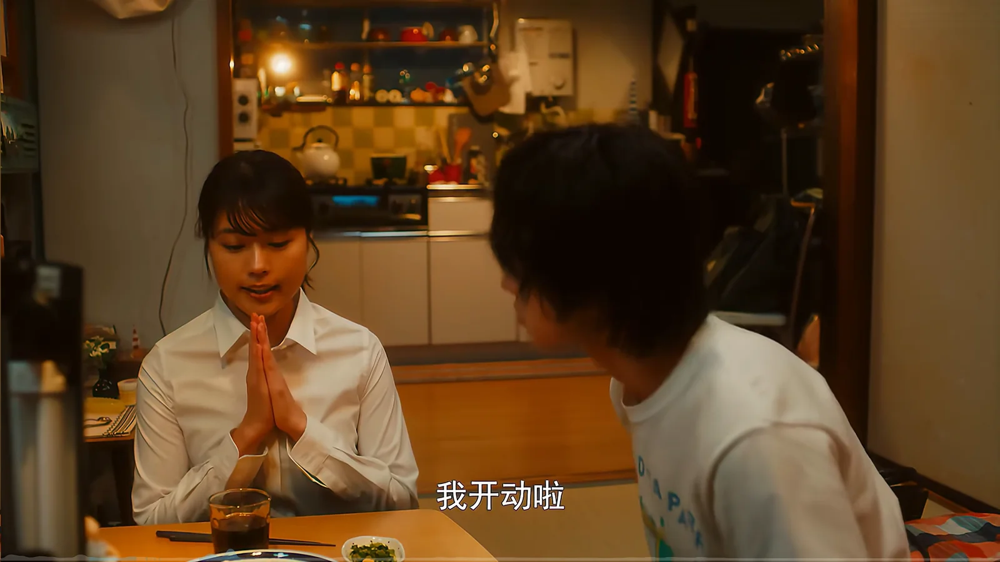
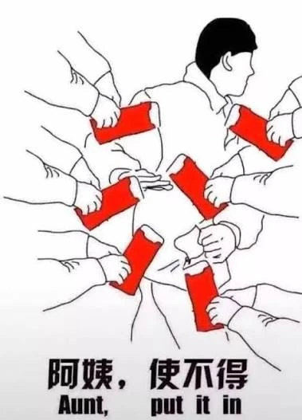

## itadakimasu

itadakimasu，如果你看过日本的电影、动漫、电视剧相信你对这个词一定不陌生。

在大多数的影视剧中，它被翻译为：「我开动了」。任何吃饭的场景开始前都会说上这么一句，即使是一个人吃饭。

但其实 itadakimasu 的意思是感谢食物，感谢食物本身。我们生命的延续是以其他生命的结束为代价的。

itadakimasu 这个词的原形的意思是：接受、被给予。所以在我理解 itadakimasu 的含义是：我带着愧疚和感恩接受这份给予。

{{}}

## 布施

现在我们再来看下另一种接受。我们把视角切到缅甸，在南传佛教中有一种修行叫做「布施」。

早晨的时候，僧人们双手捧钵，接受施主的饭。整个过程他们不与施主对视、也不说谢谢。

这场交换中谁是给予者，谁是接受者呢？正常来说僧人捧着空钵，那他一定是接受者。

但是在教义看来，僧人并不是在请求施舍，而是在给予，给予施主一个修习慷慨的机会。



## 给予

先说一个前提，我们去给予的时候，一定是希望被给予者能够感到快乐的。

关于给予，现实中有两个经典的场景：

父母去歇斯底里的指责处在青春期的孩子「不懂事」，然后大谈为了你我怎么怎么样……

情侣在吵架的时候，一方说：当初我给你的橘子，费了我 1 个月的时间，结果现在你这么对我。对方也很懵：Ta 也不知道这个橘子那么珍贵，并且 Ta 不喜欢橘子，更喜欢桃子。

错误心态的给予会让双方都不舒服，让给予者充满委屈，接受者充满愧疚。

给予不是交易，不是建立一张长期账单，给予是在共享此刻的快乐。

付出和回报这种类似交易的事情不在今天讨论的范围之内，但是人们对自己的付出往往印象更深，这经常是委屈这种情绪的来源。

## 接受

在我日常的观察中，大多数人对分享、给予这件事都非常擅长，相比来说擅长接受的人是很少的。

拿我对待「接受」的转变来说吧。

小时候没有太多的场景去接受给予，过年收压岁钱可能是为数不多的一个场景。收压岁钱这个过程中充斥的拉扯和客套。

{{}}

受这套方式的影响，我以为接受给予就应该是这样子的。所以我从小到大对于别人的给予上都是套用了收红包这套公式，基本上都会拒绝。

我是一个喜欢分享，或者说喜欢给予的人。分享好东西、分享知识、分享经历，分享和给予让我感到开心。

所以经常是我帮别人做了一件事，对方给我一些小的回馈的时候，我会感觉没必要并且拒绝。

但是有一天我忽然想到，我自己享受分享所带来的快乐，但是却拒绝让别人享受这份快乐，我好像有点太自私了。

然后我就开始坦然接受别人的给予了。这个过程中体验别人喜欢的物品，聆听别人的见解都是件很不错的事情。


