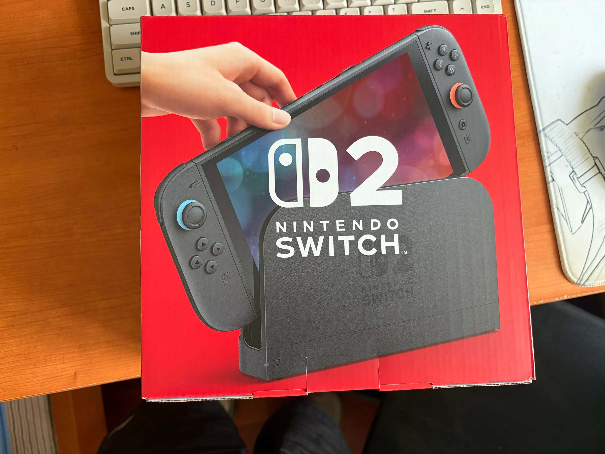

## Highlights

- Switch 2 体验

## Goal grades

每个月初，我都会设定自己想要完成的目标。以下是我完成这些目标的情况：

### 入门 Crush Agent 工具，发布两篇相关的 Blog

- **Result**：入门 Crush Agent，发布了一篇相关的 Blog
- **Grade**：B

看了 Crush Agent 主要的模块的代码，发布了 [不同 Agent 上下文压缩的实现对比](https://lixiucheng.com/agents-compact/)

Agent 工具的能力堪称恐怖，但是 Agent 主要的知识给模型提供工具调用的能力，核心的实现却并不复杂。

## Switch 2 体验

{{}}

月初的时候不知道怎么的，突然特别想买一台 Switch，这个想法就这样一直在脑袋里晃悠。
《盗梦空间》拍的一点也没过头，植入想法太可怕了。

这几年，游戏都在朝着逼真的模型、高清的世界、电影化叙事方向发展。我不喜欢这样的游戏，我不在乎我能不能看到游戏中人物的汗毛，我也不关心建筑物的细节有多么精致，
我更讨厌披着电影化叙事的外衣讲一个无聊、冗长、拖沓的故事。

游戏最重要的是玩法，而任天堂是游戏公司中最注重玩法的，所以无论如何我也要领会一下。

目前体验下来我想吐槽的点

1. 做工太垃圾了，按键松垮，板机按键的设计完全反人类
2. 屏幕没有疏油层（填写完账号信息、网络信息，准备进入游戏的时候，你会发现屏幕上全部都是指纹，并且屏幕触感特别涩）
3. 《塞尔达传说：旷野之息》想要进行高清体验还要额外付费升级（我买了你们公司最新的硬件，然后还要额外付费才能得到更好的游戏体验？生意也不是这么做的吧）

游戏方面我只体验了《超级马里奥奥德赛》和《塞尔达传说：旷野之息》，相关的内容后续会在 [游戏](https://lixiucheng.com/game-reports/) 部分更新。
《塞尔达传说：旷野之息》的交互设计用“烂”形容都太轻了。

## 回忆

九月三十号去到了哈尔滨，23 年的时候去过一次，[和队友们吃了我这辈子吃过最美味的一顿饭](https://lixiucheng.com/retrospectives/2026/05/#%E8%8D%B7%E5%B0%94%E8%92%99)。这次我到了哈尔滨，直接就奔着这家店去了，同样的菜品，但是这次的味道非常的一般。

我能回忆到的所有事情中，积极、无情感、消极的比例是多少呢？我想了一下，大概是 1:9:0。

消极的事情并没有消失，只是我现在观察这部分的回忆更多以第三视角来看，当作一段故事。而快乐的事情，每次回忆都是第一视角，能感受到当时的开心。

忘记的事就更多了，当时可能感觉很焦虑的事，伴随着下一个焦虑的到来也就烟消云散了。

## Wrap up

### What got done?

- 入门 Agent 工具
- 任天堂产品体验

### Lessons learned

- Agent 很薄

### Goals for next month

- [AUG 课程](https://www.absolutelyunderstandguitar.com/) & 课程资料翻译流程跑通
