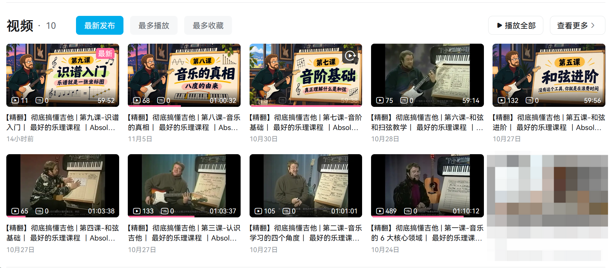
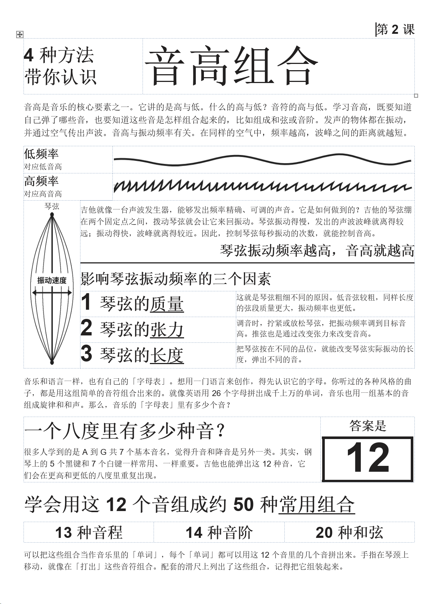
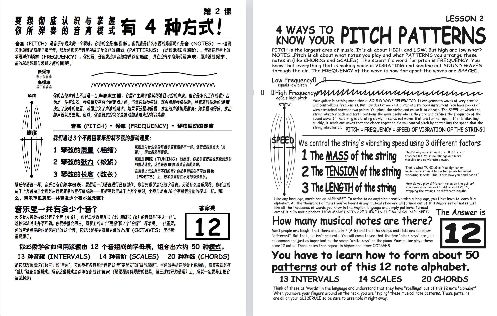

## Highlights

- 顺利跑通课程翻译流程
- 制定饮食计划
- 熟人社区发布视频

## Goal grades

每个月初，我都会设定自己想要完成的目标。以下是我完成这些目标的情况：

### [AUG 课程](https://www.absolutelyunderstandguitar.com/) & 课程资料翻译流程跑通

- **Result**：顺利完成
- **Grade**: A

视频下载、字幕制作、课程资料制作流程跑通，[截至十月底已发布 7 期视频](https://space.bilibili.com/95303150)。

{{}}

## 课程资料翻译

最开始我打算使用 Word 去制作课程资料，我认为使用 AI 工具去制作课程资料，后期不可避免的要涉及到修改的工作，Word 的后期修改相对比较方便。但是 AI 使用 Word 的效果并不好。

最终还是用 Web 技术栈去做了下，只规定了字体的使用，但是最终呈现的效果非常好，后期基本没有什么需要调整的地方。


{{}}
{{}}


工具所面向的使用者已经从人转换成了 AI，之前通过图形操作界面提升使用体验的软件，面向如今不以图形界面操作见长的 Agent，这些工具越来越不受待见。

Adobe 应该是受到这波 AI 冲击最严重的软件公司了，[前几天的发布会](https://news.adobe.com/news/2026/11/adobe-powers-new-era-of-creativity) 上宣布将在不久后提供本地 MCP 集成，来方便 AI 去使用工具。看到这个消息我有点惊讶，他们有点太晚了吧！我对 Adobe 的工具不太了解，如果只考虑工具的使用体验，这个功能应该在 Claude Opus 4.5 横空出世后不久后就应该发布了。

学习成本较高的专业软件推出 AI 调用接口，那么未来真正有价值的东西就只有想象力了。

很早就听过「未来软件面向的是 AI」的论调，但是现在来看最急切需要的是「把过去的软件改造的面向 AI」。

未来对软件的定义应该转变为：软件是一系列具有协同关系的 SKILL。

## 控制饮食

今年五月份的那段时间我很迷茫，不知道自己要干点什么，整天浑浑噩噩的，情绪很低落。

从那时我开始健身，没有训练计划，没有饮食计划，也不追求有好的训练成果。最开始的目的就是把身上的劲使完，让晚上入睡更容易一点。

但是 [有一天](https://lixiucheng.com/retrospectives/2026/05/) 锻炼之后，情绪突然特别好，脑袋里蹦出特别多的想法想要去实现。我意识到激素才是身体的主人，想要控制自己身体的最有效方式就是通过健康的生活方式去控制激素。

训练也快有半年了，效果我自己很满意。到现在距离理想的身材垫垫脚就能够到，所以这两个月规划一下饮食。

早餐：100 g 希腊酸奶，1 根香蕉，两枚鸡蛋。

午餐：一份牛肉粿条，100 g 鸡胸肉／虾仁。

晚餐：不固定。尽量高膳食纤维、蛋白质，少油少盐。

## 发布观点分享视频

解锁在熟人社区发布观点输出类的视频：最近在抖音上发布了 [以 itadakimasu 作为引子聊聊给予](https://lixiucheng.com/about-receive/) 和 [巴纳姆效应之外，谈谈星座为什么准确](https://lixiucheng.com/barnum-effect-and-constellations/) 两个视频。

我喜欢观点分享类的视频的，但是因为流量不是特别好，所以一直没行动。因为之前做过几个上千点赞的视频，所以做视频的时候经常纠结：是做有流量但是我不喜欢的视频，还是做我喜欢但是不一定有流量的视频。直到我看到了这句话：

> John Gruber：
>
> 想象你的读者就在那里。只要你坚持写下去，他们就会出现。这是我给博客新手的一条建议：我坚信，只要持续写下去，每个博客最终都会迎来与它相称的读者。为你希望拥有的读者写作，而不是只为你现在的读者写作。

## Wrap up

### What got done?

- AUG 课程工作流构建完成
- AUG 课程学习
- 控制饮食
- 发布观点输出类视频

### Lessons learned

- 软件定义的改变
- PDF & PPT 等展示类的内容可以通过 AI + Web 技术栈制作

### Goals for next month

- AUG 课程学习到第十五课
- AUG 课程尺子制作
- 观点分享类视频制作：关于特立独行
